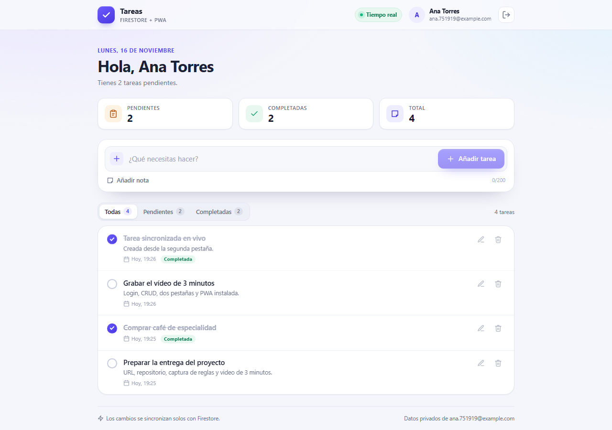
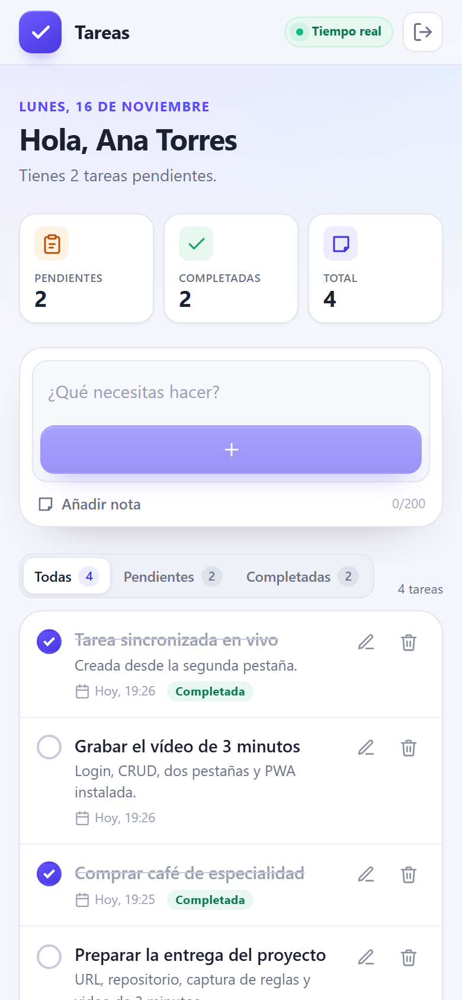

# Tareas · PWA con Firebase

Lista de tareas **privada y en tiempo real**, construida con React + Firebase y desplegable en
Firebase Hosting. Funciona con el **plan gratuito Spark** (no requiere tarjeta).

## Demo

| Entregable | Enlace |
| --- | --- |
| App desplegada | `https://TU-PROYECTO.web.app` |
| Repositorio | `https://github.com/TU-USUARIO/TU-REPO` |

> Reemplaza estos dos enlaces por los tuyos antes de entregar. La guía completa de entrega está
> en [`docs/GUIA_ENTREGA.md`](docs/GUIA_ENTREGA.md).

## Capturas

| Escritorio | Móvil |
| --- | --- |
|  |  |

## Funcionalidades

- **Authentication**
  - Registro e inicio de sesión con correo y contraseña.
  - Inicio de sesión con Google (con respaldo por redirección si el navegador bloquea popups).
  - Cierre de sesión y sesión persistente entre visitas.
  - Las pantallas de tareas solo se renderizan si hay una sesión activa.
  - Recuperación de contraseña por correo.
- **Firestore**
  - CRUD completo: crear, listar, editar, completar/descompletar y eliminar.
  - Cada tarea guarda el `uid` del usuario y las consultas filtran por ese `uid`.
  - Actualización en vivo con `onSnapshot` (sin recargar la página) e indicador de estado
    “Tiempo real” / “Sin conexión”.
- **Reglas de seguridad**
  - Solo el dueño puede leer, crear, actualizar y borrar sus tareas.
  - Se bloquea explícitamente cualquier otra colección. No hay reglas `allow ... if true`.
- **PWA**
  - `manifest.webmanifest` con iconos 192/512 y máscara, `theme_color`, `standalone`.
  - Service worker propio con caché del app shell y estrategia *network-first* para navegación.
  - Instalable en Chrome/Edge (escritorio y Android) y “Añadir a pantalla de inicio” en iOS.
- **Hosting**: configuración lista para `firebase deploy`.

## Stack

- React 19 + Vite 8
- Firebase 13 (Authentication + Cloud Firestore)
- Service worker nativo (sin plugins)
- Firebase Hosting (plan Spark)

## Requisitos

- Node.js 20.19+ o 22.12+ (recomendado 22 LTS) y npm.
- Una cuenta de Google.
- Firebase CLI: `npm install -g firebase-tools`.

> **Windows/PowerShell:** si aparece el error *“la ejecución de scripts está deshabilitada”*,
> usa `npm.cmd` en lugar de `npm` (por ejemplo `npm.cmd install`).

## Puesta en marcha local

1. **Crea y configura el proyecto de Firebase** siguiendo
   [`FIREBASE_SETUP.md`](FIREBASE_SETUP.md). Es imprescindible habilitar Authentication
   (correo/contraseña + Google), crear Firestore y publicar las reglas.
2. Instala dependencias:

   ```bash
   npm install
   ```

3. Crea el archivo de variables de entorno y rellénalo con la configuración de tu app web:

   ```bash
   # macOS / Linux
   cp .env.example .env.local

   # Windows PowerShell
   Copy-Item .env.example .env.local
   ```

   ```dotenv
   VITE_FIREBASE_API_KEY=AIza...
   VITE_FIREBASE_AUTH_DOMAIN=tu-proyecto.firebaseapp.com
   VITE_FIREBASE_PROJECT_ID=tu-proyecto
   VITE_FIREBASE_STORAGE_BUCKET=tu-proyecto.firebasestorage.app
   VITE_FIREBASE_MESSAGING_SENDER_ID=123456789
   VITE_FIREBASE_APP_ID=1:123456789:web:abc123
   ```

   > Estos valores no son secretos: son la configuración pública del cliente web. La seguridad
   > real la aportan las reglas de Firestore.

4. Arranca la app:

   ```bash
   npm run dev
   ```

   Abre `http://localhost:5173`.

Si falta alguna variable, la app muestra una pantalla de ayuda con las claves que faltan en
lugar de romperse.

## Scripts

| Comando | Descripción |
| --- | --- |
| `npm run dev` | Servidor de desarrollo de Vite. |
| `npm run build` | Build de producción en `dist/`. |
| `npm run preview` | Sirve el build localmente (útil para probar la PWA y el service worker). |
| `npm run lint` | Ejecuta Oxlint. |
| `npm run icons` | Regenera los iconos PNG de `public/icons`. |
| `npm run deploy` | Build + `firebase deploy` de Hosting y reglas. |
| `npm run deploy:rules` | Publica únicamente `firestore.rules`. |

## Estructura del proyecto

```text
.
├── public/
│   ├── icons/                 # Iconos PWA (192, 512, maskable, apple-touch)
│   ├── favicon.svg
│   ├── manifest.webmanifest
│   └── sw.js                  # Service worker
├── scripts/
│   └── generate-icons.mjs     # Generador de iconos PNG
├── src/
│   ├── components/
│   │   ├── AuthScreen.jsx     # Login, registro y Google
│   │   ├── TasksScreen.jsx    # Lista en tiempo real + CRUD
│   │   ├── TaskItem.jsx       # Ítem editable, completar y eliminar
│   │   ├── SetupScreen.jsx    # Ayuda si falta la configuración
│   │   └── Icons.jsx
│   ├── hooks/useAuth.js       # Sesión con onAuthStateChanged
│   ├── lib/errors.js          # Mensajes de error en español
│   ├── firebase.js            # Inicialización desde variables de entorno
│   ├── App.jsx                # Puerta de autenticación
│   ├── main.jsx               # Render + registro del service worker
│   ├── index.css
│   └── App.css
├── docs/GUIA_ENTREGA.md
├── firebase.json              # Hosting + Firestore + emuladores
├── .firebaserc                # Alias del proyecto (¡cámbialo!)
├── firestore.rules            # Reglas de seguridad
├── firestore.indexes.json
└── FIREBASE_SETUP.md          # Guía paso a paso del panel de Firebase
```

## Modelo de datos

Colección `tasks` (un documento por tarea):

```js
{
  uid: "ID_DEL_USUARIO",       // dueño de la tarea
  title: "Comprar café",       // string, 1..200
  notes: "Sin azúcar",         // string opcional, 0..1000
  completed: false,            // boolean
  createdAt: Timestamp,        // serverTimestamp
  updatedAt: Timestamp         // serverTimestamp
}
```

La consulta de la app es `where('uid', '==', user.uid)` y el orden se resuelve en el cliente,
por lo que **no necesitas índices compuestos** en Firestore.

## Reglas de seguridad

El archivo [`firestore.rules`](firestore.rules) garantiza que un usuario no pueda leer ni
modificar tareas ajenas:

- `read` / `delete`: solo si `resource.data.uid == request.auth.uid`.
- `create`: solo autenticado y con `request.resource.data.uid == request.auth.uid`.
- `update`: solo el dueño, sin poder cambiar `uid`, `createdAt` ni campos desconocidos.
- Cualquier otra ruta: `allow read, write: if false`.

Para publicarlas:

```bash
firebase deploy --only firestore:rules
```

O pégalas en **Firestore Database → Reglas** y pulsa **Publicar** (es lo que se captura para la
entrega).

## PWA: probar la instalación

El service worker se registra **solo en producción** (build), no en `npm run dev`.

```bash
npm run build
npm run preview
```

Abre `http://localhost:4173` en Chrome/Edge:

- Escritorio: icono de instalar en la barra de direcciones o menú → *Instalar Tareas*.
- Android: menú → *Añadir a pantalla de inicio* / *Instalar app*.
- iOS/Safari: compartir → *Añadir a pantalla de inicio*.

En `DevTools → Application` puedes revisar el manifest, el service worker y la caché.

## Desarrollo con emuladores (opcional)

Para probar sin tocar tu proyecto real:

1. Crea `.env.local` con valores de ejemplo y añade `VITE_USE_EMULATORS=true`:

   ```dotenv
   VITE_FIREBASE_API_KEY=demo-api-key
   VITE_FIREBASE_AUTH_DOMAIN=demo-tareas.firebaseapp.com
   VITE_FIREBASE_PROJECT_ID=demo-tareas
   VITE_FIREBASE_STORAGE_BUCKET=demo-tareas.appspot.com
   VITE_FIREBASE_MESSAGING_SENDER_ID=123456789
   VITE_FIREBASE_APP_ID=1:123456789:web:demo
   VITE_USE_EMULATORS=true
   ```

2. Arranca los emuladores (necesita Java para Firestore):

   ```bash
   firebase emulators:start --only auth,firestore --project demo-tareas
   ```

3. En otra terminal: `npm run dev`.

Los datos viven solo en memoria y desaparecen al apagar los emuladores. El proveedor de Google
no está disponible en el emulador de Authentication: usa correo/contraseña para las pruebas.
La interfaz de los emuladores queda en <http://127.0.0.1:4000>.

## Despliegue en Firebase Hosting

```bash
# 1. Autentícate (abre el navegador)
firebase login

# 2. Asocia la carpeta con tu proyecto
firebase use --add
#    Elige tu proyecto y escribe el alias "default"

# 3. Build + deploy de Hosting y reglas
npm run build
firebase deploy --only hosting,firestore:rules
```

También puedes editar `.firebaserc` y poner tu `projectId` en lugar de `TU_PROYECTO_ID`, y
usar `npm run deploy`.

Al terminar verás dos URLs:

- `https://TU-PROYECTO.web.app`
- `https://TU-PROYECTO.firebaseapp.com`

Ambas quedan autorizadas automáticamente para Authentication.

> Cada vez que cambies variables de entorno debes volver a ejecutar `npm run build` y
> `firebase deploy`, porque Vite las inserta en el build.

## Comprobar el tiempo real en dos pestañas

1. Inicia sesión y abre la app en dos pestañas del mismo navegador (o en dos dispositivos).
2. Añade, edita, completa o elimina una tarea en una pestaña.
3. La otra se actualiza sola gracias a `onSnapshot`, sin recargar.

## Comprobar que las reglas aíslan a los usuarios

**Prueba con dos cuentas**

1. Crea la cuenta A y añade varias tareas. Copia el `uid` de la cuenta A en
   **Authentication → Users**.
2. En una ventana de incógnito crea la cuenta B: su lista aparece vacía aunque A tenga tareas.
3. Intenta acceder a una tarea de A con la sesión de B. La forma más rápida es el
   **Simulador de reglas** de la consola:
   **Firestore Database → Reglas → Simulador de reglas**, con:
   - Tipo: `get`, Ubicación: `tasks/ID_DE_UNA_TAREA_DE_A`
   - Autenticación: activada, UID: el de la cuenta B.
   - Resultado esperado: **Denegado**.
4. Repite con el UID de A: **Permitido**.

Las reglas también impiden cambiar el `uid` de una tarea, crear tareas a nombre de otro usuario
y leer cualquier colección distinta de `tasks`.

## Solución de problemas

| Problema | Causa / solución |
| --- | --- |
| `auth/unauthorized-domain` | Añade el dominio en **Authentication → Settings → Authorized domains**. |
| `auth/operation-not-allowed` | Habilita Email/Password y Google en **Authentication → Sign-in method**. |
| `permission-denied` al guardar | Las reglas no están publicadas o el `uid` no coincide con el usuario. |
| Pantalla “Falta conectar Firebase” | No existe `.env.local` o faltan variables. Reinicia `npm run dev`. |
| Google no abre en la PWA | El popup se bloquea; la app cambia automáticamente a redirección. |
| `firebase: command not found` | `npm install -g firebase-tools` o usa `npx firebase-tools`. |
| `npm.ps1 cannot be loaded` (Windows) | Usa `npm.cmd` o ejecuta `Set-ExecutionPolicy -Scope CurrentUser RemoteSigned`. |
| La PWA no ofrece instalarse | Debe servirse por HTTPS (o localhost), con manifest, iconos 192/512 y service worker. |
| Cambios que no aparecen tras desplegar | El service worker sirve caché: recarga forzada o sube `VERSION` en `public/sw.js`. |

## Licencia

Proyecto académico de ejemplo. Úsalo y adáptalo libremente.
